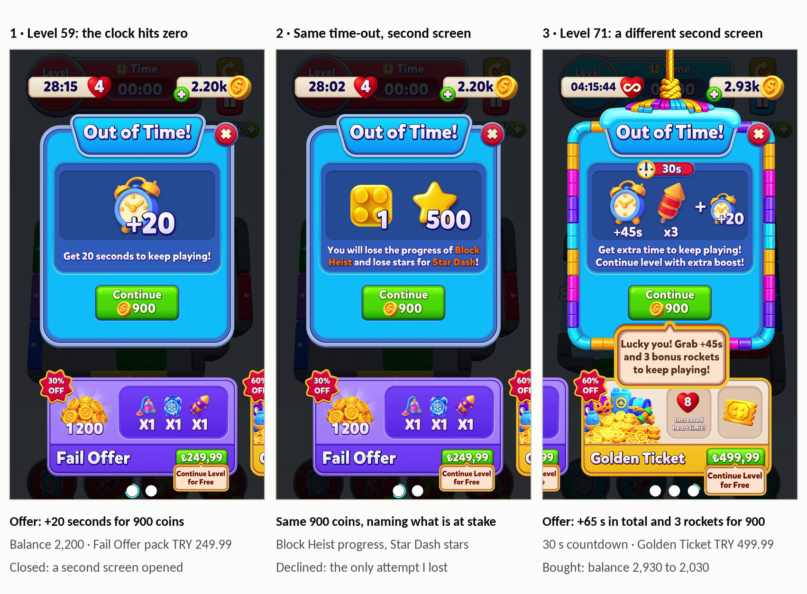
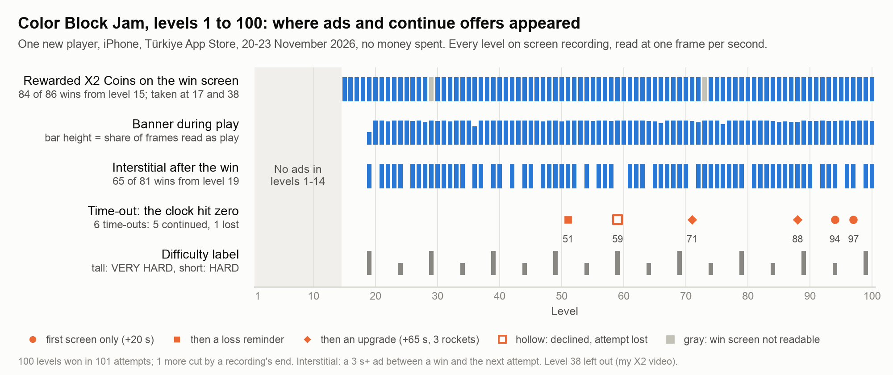

# Out of time in Color Block Jam

When the clock runs out in Color Block Jam, the first offer is +20 seconds for 900 coins. When I closed it at level 59, a second screen listed the event progress I would lose; at level 71, the second screen offered +65 seconds in total and 3 rockets for the same 900 coins. That gap raises a product question: does a stronger second offer, while it saves the attempt, teach players to close the first offer next time?



This is an independent player study of one new account's first 100 levels (iPhone, Türkiye App Store, 20 to 23 November 2026), not affiliated with Rollic. I spent no money, recorded every level on screen and turned the recordings into tables. It uses the method and metric ids of my [Royal Kingdom first-100 study](https://github.com/dorukozcan/royal-kingdom-first-100), so the two games can be compared metric by metric; where the level ranges or the units differ, the table and the scorecard say so.

**What I observed**

- **Scope.** 102 recorded attempts: 100 wins, 1 loss (level 59) and 1 attempt cut by the end of a recording. Six time-outs, no real money spent.
- **First offer.** All six time-outs opened on +20 seconds for 900 coins. I took it twice (levels 94 and 97) and closed it four times.
- **Second offer.** All four closes opened a second screen at the same 900 coins: a reminder of the event progress at stake (levels 51 and 59) or an upgrade to +65 seconds in total and 3 rockets with a 30-second countdown (levels 71 and 88). On this account I bought the reminder once in two and the upgrade both times, and all five attempts I continued with coins were won.
- **Real money on the same screen.** Packs that each promise "Continue Level for Free" changed between time-outs: Fail Offer TRY 249.99 and Golden Ticket TRY 499.99 at levels 51 and 59, Coin Madness TRY 49.99 added at level 71, with Fail Offer at 88 and alone at 94 and 97. My balance covered the 900 coins at every time-out (2,200 to 3,800).
- **Ads around it.** The rewarded X2 Coins button was first seen at level 15, the banner and the first interstitial at level 19; the banner showed on 98.3% of the level 20-100 frames read as gameplay. An interstitial was seen between the win and the next attempt after 65 of 81 wins (level 38 left out, where I chose the X2 video; level 27's spans two recordings), median observed ad episode 15 seconds. Measured from the end of the previous full-screen ad to the win screen, over the 75 wins where that ad was seen in the same recording, 0 of 10 gaps under 60 seconds and 60 of 65 longer ones were followed by one: on this account, consistent with a minimum interval of about a minute.

**The note.** One page: the two second screens, the ads around them, the comparison with Royal Kingdom and the test I would run: [memo/out_of_time.pdf](memo/out_of_time.pdf) ([markdown](memo/out_of_time.md)).

This is one player's log. It shows what happened to me, not what happens on average.

## The test I would run (not run)

The question: does a stronger second offer at the same price help players finish the attempt, and does it teach them to close the first offer at later time-outs?

- **Assignment.** Players who close the first offer while holding at least 900 coins, with event progress really at stake so that both screens are true, are assigned at random at that close, before the second screen shows. They stay in their arm.
- **Arms.** The loss reminder against the upgrade. Time, rockets, countdown and text change together, so this compares two offer packages. The price stays at 900 coins and, where possible, the real-money cards stay fixed.
- **Primary metric.** Among all assigned players, the share who win the attempt of their first eligible close, buyers and non-buyers alike. Coin continues and real-money continues are reported separately.
- **Learning to close the first offer.** At each later time-out, eligibility is set before the player chooses: at least 900 coins and event progress at stake. The denominator is every later first offer shown to an assigned player while those conditions hold, first-offer purchases included; the numerator is the first-offer purchases. The arms can change how often players reach a later time-out, so the report gives, per player, both the number of later eligible encounters and the number of first-offer purchases, and the analysis works at the player level so that one player's repeated encounters are not counted as independent.
- **Monetization guardrails.** Coin spend, real-money revenue and D1/D7 return, each with a measurement window and an acceptable loss written down before launch.
- **Decision.** The minimum lift on the primary metric and the limit for every guardrail are set before launch. A package advances to a pilot against the current flow only if it clears the preset minimum lift and stays within every guardrail. If the result is inconclusive, the current flow stays.
- **Roll-out.** This test only chooses which package goes to the pilot. Whether to roll it out is decided by the pilot against the current flow, on the same primary metric, learning measure and guardrails.
- **Not from this data.** Four closes on one account cannot give an effect size or a sample size.

## Level by level



## Compared with Royal Kingdom

| | Royal Kingdom | Color Block Jam |
|---|---|---|
| Attempts / lost attempts, levels 1-100 | 179 / 79 | 101 / 1, plus 1 cut by the end of a recording |
| First continue offer | +5 moves for 900 coins | +20 seconds for 900 coins |
| How the offer changes | grew in five-move steps on retries, reaching an observed maximum of +35 | a second screen in the same time-out, same price |
| Offers the balance covered: bought | 7 of 19 offer screens | 5 of 10 offer screens (5 of 6 time-outs) |
| Ads | none in 21,713 recorded frames (levels 15-100) | rewarded button from level 15; banner and interstitials from level 19, an interstitial after 65 of 81 wins |
| Coins spent on continues, share of coin income | 98% (levels 15-100) | 71% (levels 1-100), a derived estimate: income includes 2,380 coins read from balance steps |

The full scorecard, metric by metric with its source: [scorecard.md](scorecard.md).

## What is here

| Path | Contents |
|---|---|
| `memo/out_of_time.md`, `.pdf` | The one-page note |
| `figures/out_of_time_screens.png` | The three screens at the top, each one frame of a recording, cropped to the game's screen. The captions repeat `data/offers.csv` |
| `figures/first_100_levels.png` | The level-by-level chart, drawn from the tables |
| `data/attempts.csv` | One row per attempt (102): level, result, balance at the start, continues, gameplay and banner frames, the rewarded button |
| `data/offers.csv` | One row per time-out (6): screens shown, real-money packs, balance, decision, seconds to decide |
| `data/ads.csv` | One row per full-screen ad episode the parser found (67): the 65 interstitials seen after wins and the two rewarded videos I chose |
| `data/levels.csv` | One row per level (100): the difficulty label the game showed |
| `data/recordings.csv` | One row per recording (9): day, length, levels |
| `DATA_DICTIONARY.md` | Every column, and how each value was obtained |
| `analysis/check_note_numbers.py` | 49 data checks: computes the numbers in the note and the scorecard from the tables and compares each with a fixed expected value |
| `analysis/make_figure.py` | Draws the figure above from the tables |
| `analysis/parse_cbj.py`, `derive_cbj.py` | How the tables were made from the recordings. They need the OCR text, which is not published |
| `memo/build_pdf.py` | Rebuilds the note's PDF from its markdown |
| `scorecard.md` | Royal Kingdom and Color Block Jam side by side, same metric ids |

## Reproduce the numbers

Python 3.8 or later. The checks need only the standard library:

```bash
python3 -I analysis/check_note_numbers.py
```

It should end with `49 data checks passed`. It computes values from the tables and compares each with a fixed expected value written into the script. It does not read the note or the PDF, so it shows that the tables still give the reported numbers, not that the note quotes them correctly.

The figure needs matplotlib:

```bash
python3 analysis/make_figure.py
```

`python3 -I memo/build_pdf.py memo/out_of_time.md --max-pages 1` rebuilds the PDF; it uses Google Chrome's macOS path.

## How the data was made

1. Screen recordings of every level from 1 to 100: 9 recordings, 227 minutes. One of them is a 49-second check of the home screen and the shop before level 50.
2. [`video_ocr.swift`](https://github.com/dorukozcan/royal-kingdom-first-100/blob/main/analysis/video_ocr.swift) from the Royal Kingdom repository takes one frame per second and runs Apple's on-device text recognition on it.
3. `parse_cbj.py` recognises the game's screens by their fixed English text and finds attempts, time-outs, wins, balances and ad episodes. A frame with an ad's badge or call to action ("Play Now", "Open Store", "Install") counts as an ad even when the ad also shows game-like words. An interstitial is a full-screen ad seen between a win and the next attempt that I did not choose; its length is the observed length of the ad episode. One was seen across two recordings: R02 ends on the level 27 win screen, and R03 opens with the ad, then the same win screen, then level 28. `derive_cbj.py` adds the banner frames, the seconds to decide and the difficulty labels.
4. I checked every time-out and offer screen by eye on the video frame. Prices and offer contents were read from the screen, not parsed.

The OCR tool is Swift and the analysis scripts are Python, written with Claude Code.

The coins add up. Each level-start balance matches the previous one plus 40 per win and minus 900 per continue, except at 11 steps that add 2,380 coins in total, a figure computed from the balance differences. 80 of it is the X2 Coins bonus (+40 each) from the rewarded videos I chose at levels 17 and 38, which is how those two ads are told apart from interstitials; the other 2,300 coins are not yet matched to rewards on the frames. Two scorecard shares rest on this total and are derived estimates: 37% of coin income from these steps (D2) and 71% of coin income spent on continues (D4). Starting from 400, plus 4,000 from 100 wins, plus 2,380, minus 4,500 for five continues, the balance comes to 2,280, the figure on screen after level 100. It carries over unchanged between recordings. Above 1,000 the game shows the balance as, for example, 2.28k, so those readings are exact to 10 coins.

## What is not here, and why

- The recordings and the OCR text. They show my account details, notifications and other apps. The three screenshots are single frames, cropped to the game's screen without the banner ad.
- My working notes. They are in Turkish and personal; the tables carry the structured fields.
- Recording file names and times of day. Recordings are called R01 to R09 and dates are kept to the day.

## Limits

One player, one device, one store, prices in TRY. Six time-outs and four closed first offers in 100 levels, so the fail findings are examples, not rates. The rule that picks the second screen could not be inferred from these observations. I knew I was recording, so my play may differ from a typical player's. Not done yet: matching nine coin steps to their frames, the Cloud Rise win-streak metrics (scorecard E2-E5) and the new items after level 9 (F2). The game version was 13.1.5 and tracking (App Tracking Transparency) was on, both read in the iPhone's settings on 25 November 2026, two days after the last recording. The tracking prompt appeared at the first launch.

## Notes

Screenshots from Color Block Jam, listed on the App Store by Rollic Games.

Doruk Özcan · [linkedin.com/in/doruk-ozcan](https://www.linkedin.com/in/doruk-ozcan)
